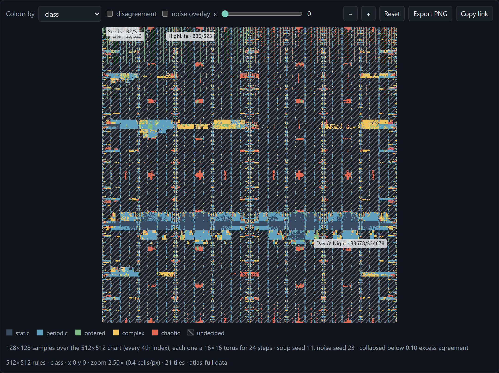
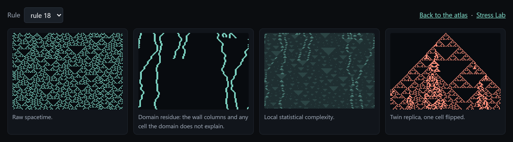

# Computation Atlas

**A navigable map of the space of simple programs** — showing where order ends, chaos begins, and
computation lives in between.

[](https://github.com/JoeyHammoth/chaotic-automata/actions/workflows/ci.yml)
[](https://github.com/JoeyHammoth/chaotic-automata/actions/workflows/pages.yml)
[](LICENSE)
[](pyproject.toml)

**[Open the atlas →](https://joeyhammoth.github.io/chaotic-automata/)** — no install, no account, no
server. The same build serves five pages: the [Atlas](https://joeyhammoth.github.io/chaotic-automata/),
the [Inspector](https://joeyhammoth.github.io/chaotic-automata/inspector.html), the
[Stress Lab](https://joeyhammoth.github.io/chaotic-automata/stress.html), the
[Verifier](https://joeyhammoth.github.io/chaotic-automata/verifier.html) and the
[HashLife zoom](https://joeyhammoth.github.io/chaotic-automata/hashlife.html).



*The deployed atlas: 512 × 512 rules, coloured by behaviour class, with hatching for the 75.8% that
are `undecided` at these budgets. The status line under the map carries the view's reproduce state.*

Every pixel of the atlas is a different cellular automaton, coloured by what it *does* (frozen,
periodic, chaotic, capable of computation), with visible "coastlines" where behaviour changes
character. Any point can be run live, and opened in instruments that look *inside* the rule: domains
and particles, a HashLife zoom where Life runs inside Life, and a noise lab where reliable
computation either survives or dies.

One rule at a time, the [Inspector](https://joeyhammoth.github.io/chaotic-automata/inspector.html)
shows the raw spacetime, the cells its inferred domain does not explain, the local statistical
complexity, and a twin replica that differs by a single cell. This is rule 18, one of the anchors
[`docs/methods.md`](docs/methods.md) verifies:



| | |
|---|---|
| **Status** | The atlas is live: a 512×512 map of rule space with class and metric colourings, hatching for undecided rules, a disagreement layer, landmark labels and click-to-run. Data comes from the full sweep: 24 warm steps, 300 observed steps, a 300-step period cap and six seeds per rule, the same budgets as the 64x64 sample; 75.8% of rules stay undecided there and the map hatches them. |
| **Design** | [`source/Computation_Atlas_v2_Design_Doc.md`](source/Computation_Atlas_v2_Design_Doc.md) — draft 2, sections 0–12 plus appendices |
| **Deliverable** | Static, serverless web app on GitHub Pages, plus a reproducible offline data pipeline |
| **Audience** | Admissions committees, research-software hiring managers, computational physics / ML-for-science teams |

> The design is complete: architecture, data products, instrument interfaces, frontend, performance
> budgets, validation targets, deployment, schedule, risks and appendices. [`docs/architecture.md`](docs/architecture.md)
> is the short summary for day-to-day work; the design document is authoritative.

## Why it is not a demo

1. **Frontier methods used for real**, not name-dropped: foundation-model illumination of rule space
   (ASAL), differentiable logic CA, certificate-carrying Busy Beaver deciders, hierarchical
   fault-tolerant CA, local causal states.
2. **Scientific honesty as a feature.** Competing complexity metrics are shown side by side,
   undecidable cases get an explicit *undecided* class, every figure carries seed, version and a
   reproduce link.
3. **Serious engineering.** Rust→WebAssembly engines, WebGPU compute with a fallback ladder, a
   validation suite against published results, differential testing (GPU vs CPU vs reference), and
   CI-driven static deployment.
4. **The chart is the interface.** The hero is the live atlas.

## Why this, and not Golly, a notebook, or CAX?

- **Golly** is the mature, far faster tool for exploring Life patterns, and it is the right one for
  that job. This asks a different question: what all 262,144 Life-like rules do at once, as one map
  measured the same way at every pixel. Golly is also GPL, so it appears here only as a black-box
  oracle in tests, never as linked code.
- **A notebook** is better for a one-off experiment. It is worse at what this project is for: a
  figure that carries its rule, seed and version, and a link that restores the view exactly.
- **CAX** is a better starting point if you want to train or search rules on a GPU. This is a
  read-only atlas of measured behaviour, not a differentiable simulator.

What it cannot show is stated plainly in [`docs/limitations.md`](docs/limitations.md) rather than left
for a visitor to discover.

## Modules

| Tier | Module | One-liner |
|---|---|---|
| Core | **M1 Atlas** | Zoomable map of rule space with multiple colourings |
| Core | **M2 Inspector** | Domains, particles and local complexity for 1D CA |
| Core | **M3 HashLife Zoom** | Infinite zoom in space and time through Life |
| Core | **M4 Stress Lab** | Noise, Toom's rule, directed percolation, hierarchical error correction |
| Signature (pick one) | **M5a Forge** | Learn discrete CA rules by gradient descent |
| Signature (pick one) | **M5b Verifier** | Decide Turing machines with checkable certificates and an *unknown* class |
| Stretch | **M6 Compiler** | Compile a cyclic tag system into a Rule 110 initial condition |
| Stretch | **M7 Heritage** | The original sandpile lab rebuilt on the shared engine |

Recommended spine: **M1 + M2 + M3 + M4 + one of M5a/M5b**. M6 and M7 are cut lines; see
[`docs/ROADMAP.md`](docs/ROADMAP.md).

## Repository map

```text
source/
  Computation_Atlas_v2_Design_Doc.md   # the design (sections 0–12 + appendices)
  python/                              # legacy sandpile lab — heritage (M7), not yet migrated
src/computation_atlas/                 # offline data pipeline (Python)
tests/                                 # pipeline tests
crates/                                # Rust engine workspace: ca-core, ca-wasm (ADR 0004)
site/                                  # TypeScript app: Vite, canvas, URL state
docs/
  architecture.md                      # short architecture summary
  methods.md                           # scientific methods, constants and citations
  limitations.md                       # what this cannot show, and why
  ROADMAP.md                           # milestones, spine and cut lines
  research/design-doc-review.md        # citation verification and gap analysis
  adr/                                 # architecture decision records
  agents/                              # issue tracker, triage labels, domain doc rules
scripts/                               # repository checks (docs links)
products/                              # committed data products the site reads
.github/workflows/                     # CI and Pages
```

## Run it locally

Python 3.11+ is required for the offline pipeline.

```bash
python -m venv .venv
source .venv/bin/activate        # Windows: .venv/Scripts/activate
pip install -e ".[dev]"
pytest -q
ruff check .
```

The engine and the site have their own toolchains:

```bash
cargo test --workspace                    # packed engine vs the u8 reference, bit-exact
cd site
npm install
npm run build:wasm                        # optional; without it the site uses the CPU reference
npm run dev                               # http://127.0.0.1:5173/?rule=B3/S23&seed=1
npm run typecheck && npm test              # site unit tests
npm run e2e                               # headless smoke test (npx playwright install chromium first)
```

The legacy sandpile lab is separate and self-contained:

```bash
cd source/python
pip install -r <(pipenv requirements)   # or install numpy/scipy/matplotlib directly
python main.py
```

It writes plots into `Grids/`, `Histograms/`, `Line_Plots/` and `Log_Plots/`.

## Engineering standards

- **Two implementations, one truth.** Every engine is checked against an independent reference
  (see [ADR 0002](docs/adr/0002-two-implementations-differential-testing.md)); GPU and CPU tiers must
  agree bit-for-bit on deterministic rules.
- **Determinism.** Every artefact records rule, seed and version hash. A figure without a reproduce
  link is a bug.
- **Undecided is a result.** Budget caps produce *undecided*, never "chaotic" (see
  [ADR 0003](docs/adr/0003-undecided-first-class-outcome.md)).
- **No borrowed engines.** Golly and other GPL implementations are black-box oracles for tests only;
  their code stays out of the repo.

## Documentation

| Document | Use it for |
|---|---|
| [`docs/methods.md`](docs/methods.md) | Algorithms, verified constants, citations |
| [`docs/performance.md`](docs/performance.md) | Measured load and frame time on the deployed build |
| [`docs/limitations.md`](docs/limitations.md) | Honest scope and failure modes |
| [`docs/troubleshooting.md`](docs/troubleshooting.md) | What a surprising symptom means, and what to do |
| [`docs/architecture.md`](docs/architecture.md) | Proposed system layout and data flow |
| [`docs/ROADMAP.md`](docs/ROADMAP.md) | Milestones and ordering |
| [`docs/research/design-doc-review.md`](docs/research/design-doc-review.md) | Which claims check out, and what is missing |
| [`CONTRIBUTING.md`](CONTRIBUTING.md) | Branch, commit, issue and PR workflow |
| [`AGENTS.md`](AGENTS.md) | Instructions for coding agents |
| [`CODE_OF_CONDUCT.md`](CODE_OF_CONDUCT.md) | Expected behaviour, and the private reporting route |
| [`SECURITY.md`](SECURITY.md) | Supported versions and how to report a vulnerability |
| [`SUPPORT.md`](SUPPORT.md) | Where to ask a question, and where not to |
| [`CITATION.cff`](CITATION.cff) | How to cite the software and its data products |

## Primary references

- Kumar et al., *Automating the Search for Artificial Life with Foundation Models* —
  [arXiv:2412.17799](https://arxiv.org/abs/2412.17799)
- Miotti, Niklasson, Randazzo, Mordvintsev, *Differentiable Logic Cellular Automata* —
  [arXiv:2506.04912](https://arxiv.org/abs/2506.04912)
- bbchallenge Collaboration, *Determination of the fifth Busy Beaver value* —
  [arXiv:2509.12337](https://arxiv.org/abs/2509.12337)
- Rupe & Crutchfield, *Local Causal States and Discrete Coherent Structures* —
  [arXiv:1801.00515](https://arxiv.org/abs/1801.00515)
- Faldor & Cully, *CAX: Cellular Automata Accelerated in JAX* —
  [arXiv:2410.02651](https://arxiv.org/abs/2410.02651)
- Balasubramanian, Davydova, Lake, *A local automaton for the 2D toric code* —
  [arXiv:2412.19803](https://arxiv.org/abs/2412.19803), Quantum **10**, 2125 (2026)
- Dünnweber, Styliaris, Trivedi, *Quantum Memory and Autonomous Computation in Two Dimensions* —
  [arXiv:2601.20818](https://arxiv.org/abs/2601.20818)

## Contributing

Every change starts from an issue; [`CONTRIBUTING.md`](CONTRIBUTING.md) has the branch, commit and
pull-request workflow and the check each toolchain runs. Work that suits a first-time contributor is
labelled [`good first issue`](https://github.com/JoeyHammoth/chaotic-automata/issues?q=is%3Aopen+label%3A%22good+first+issue%22)
and [`help wanted`](https://github.com/JoeyHammoth/chaotic-automata/issues?q=is%3Aopen+label%3A%22help+wanted%22);
each one states the expected outcome, where the relevant code lives, and how to check the result.
There is no CLA to sign.

This is a single-maintainer project, so issues and pull requests are answered on a best-effort basis
with no service-level promise. If something has gone quiet, a polite ping is welcome.

## Support

Questions and bug reports go to [Issues](https://github.com/JoeyHammoth/chaotic-automata/issues);
[`SUPPORT.md`](SUPPORT.md) says which route fits. A suspected vulnerability goes through private
reporting, never a public issue — see [`SECURITY.md`](SECURITY.md).

## License

MIT — see [`LICENSE`](LICENSE).

The licence covers the source, the data products under `products/` and the figures generated from
them, so a figure can be reused with its reproduce link and no further permission.
